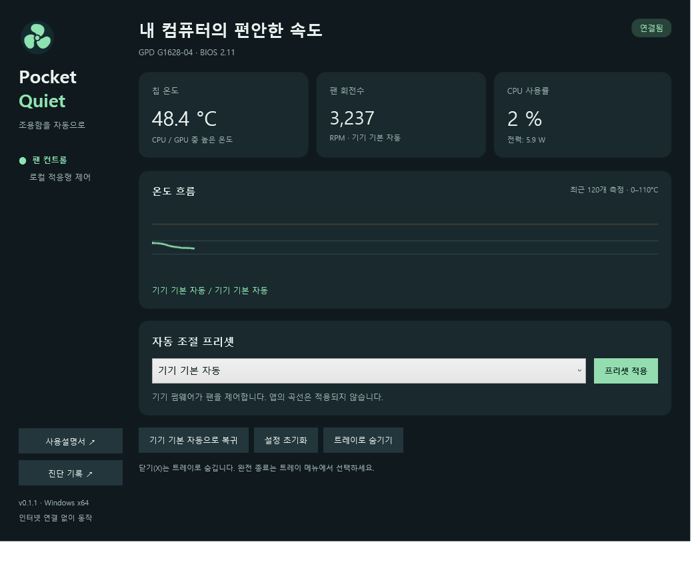

# Pocket Quiet

**Local, temperature-aware fan control for GPD Pocket 4 on Windows.**

Pocket Quiet combines a Korean Windows desktop interface, a dedicated control service, and a recovery watchdog. It offers adaptive, quiet, balanced, cooling-first, and custom-curve presets, with a one-click return to firmware control.

> **Version 0.1.1 — hardware-tested preview.** Manual control is restricted to GPD Pocket 4 (`G1628-04` / `G1628-04-L`) with BIOS `2.11`. Physical validation was performed on **G1628-04 / Ryzen AI 9 HX 370** only; the `-L` variant is protocol-matched but not physically tested. Other models and BIOS versions are monitoring-only. This is not a universal laptop fan controller.



## 다운로드 / 설치

1. [Releases](../../releases)에서 `PocketQuiet-0.1.1-win-x64.zip`을 다운로드하고 압축을 모두 풉니다.
2. `Install.cmd`를 실행합니다. 관리자 권한 요청을 승인하면 서명이 검증된 PawnIO와 Pocket Quiet 서비스가 설치됩니다.
3. 바탕화면의 **Pocket Quiet** 바로가기를 실행합니다.
4. 기기·온도·RPM이 표시되고 연결 상태가 정상인지 확인합니다.
5. **AI 자동 · 적응형** 또는 **저소음**을 선택한 다음 **프리셋 적용**을 누릅니다.

앱은 자체 .NET 런타임을 포함합니다. Windows 11 x64에서 시험했습니다. 기존 FanControl, MotionAssistant 등의 팬 제어는 먼저 종료하세요. 처음 실행, 서비스 재시작, 절전 복귀 시에는 기기 기본 자동으로 시작합니다.

자세한 안내: [사용설명서](docs/USER_GUIDE.ko.md) · [개발명세서](docs/DEVELOPMENT.ko.md) · [검증 기록](docs/VALIDATION.md) · [변경 이력](CHANGELOG.md)

## Features

- Real CPU/APU temperature, fan RPM, CPU load, and package power when available.
- Firmware automatic, Adaptive (AI-labelled), Quiet, Balanced, Cooling, and Custom presets.
- Temperature trend anticipation, exponential smoothing, delayed deceleration, and bounded outputs.
- Immediate 100% cooling request at 85°C; this is an application policy, not a manufacturer rating.
- Sensor validation, persistent-stall detection, write/read-back verification, and firmware fallback.
- Privileged Windows service separated from the WPF interface; closing the window hides it to the tray.
- Separate heartbeat watchdog plus Windows Service Control Manager restart recovery.
- Local bounded logs; no analytics, cloud inference, API keys, accounts, or network access during normal operation.
- Editable five-point curve, preference slider, live chart, reset, and recovery/uninstall scripts.

**“AI automatic” means deterministic, local adaptive rules.** There is no neural network, language model, online training, persistent learned model, or hidden cloud service. CPU load and power are displayed for diagnosis; temperature and temperature slope drive fan control.

## Safety and limitations

Manual outputs are limited to 30–100%; zero-RPM operation is intentionally unavailable. 85°C triggers maximum cooling without smoothing. The UI displays output percentage separately from measured RPM. Lower fan speed may raise temperature; it cannot eliminate heat from sustained workloads or repair a damaged fan.

The watchdog can recover from many user-space process failures, but cannot guarantee recovery from an OS/kernel hang, power loss, a failed driver, firmware interference, or hardware faults. No thermal protection is disabled. Long-duration load, real suspend/resume, all Windows updates, and other devices are **not** comprehensively validated. Do not treat a short functional test as a thermal certification.

Executable files are not Authenticode-signed. The **PawnIO installer** is independently signed by its publisher and verified by the installation script. Do not disable Windows security to run the software. If security policy blocks a component, keep firmware control and investigate compatibility.

## Build

.NET 10 SDK is required to build. Windows x64 is required to run the service and app. Cross-compilation from Linux is supported.

```powershell
./scripts/build.ps1
```

```bash
./scripts/build.sh
```

The core test executable is dependency-light and cross-platform:

```bash
dotnet run --project tests/PocketQuiet.Tests -c Release
```

Artifacts are written to `artifacts/app` and `artifacts/service`. Install Python 3.10+ and `python -m pip install -r scripts/requirements.txt`, then run `python scripts/package.py` after building to assemble the installable package. Packaging downloads the pinned, unmodified PawnIO installer and validates its SHA-256. See the development specification for IPC, control policy, installation layout, and failure behavior.

## Contributing / device support

Do not extend the allowlist based only on a similar product name. Contributions for a new device or BIOS must include authoritative EC protocol references, reversible control/restore tests, temperature/RPM evidence, and recovery results. Never publish serial numbers, account names, private logs, credentials, or unrelated screenshots. Open an issue with the model, BIOS, Windows version, and a redacted failure description.

## License and credits

Pocket Quiet source is **GPL-2.0-or-later**. Hardware access is adapted from [Cryolitia/gpd-fan-driver](https://github.com/Cryolitia/gpd-fan-driver), the [Linux GPD driver](https://github.com/torvalds/linux/blob/master/drivers/hwmon/gpd-fan.c), and [chenx-dust/FanControl.GPDPlugin](https://github.com/chenx-dust/FanControl.GPDPlugin). Monitoring uses [LibreHardwareMonitor](https://github.com/LibreHardwareMonitor/LibreHardwareMonitor) (MPL-2.0). Driver access uses the official signed [PawnIO](https://pawnio.eu/) distribution.

See [THIRD-PARTY-NOTICES.md](THIRD-PARTY-NOTICES.md) and [LICENSE](LICENSE). No affiliation with or endorsement by GPD is implied.
